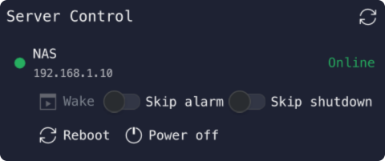
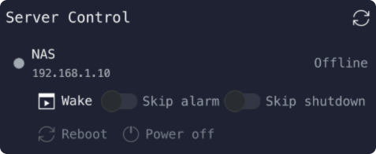
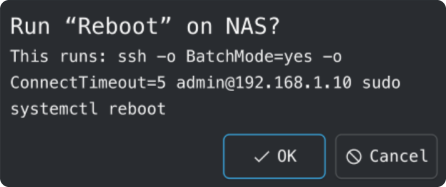
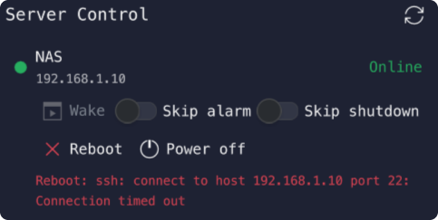
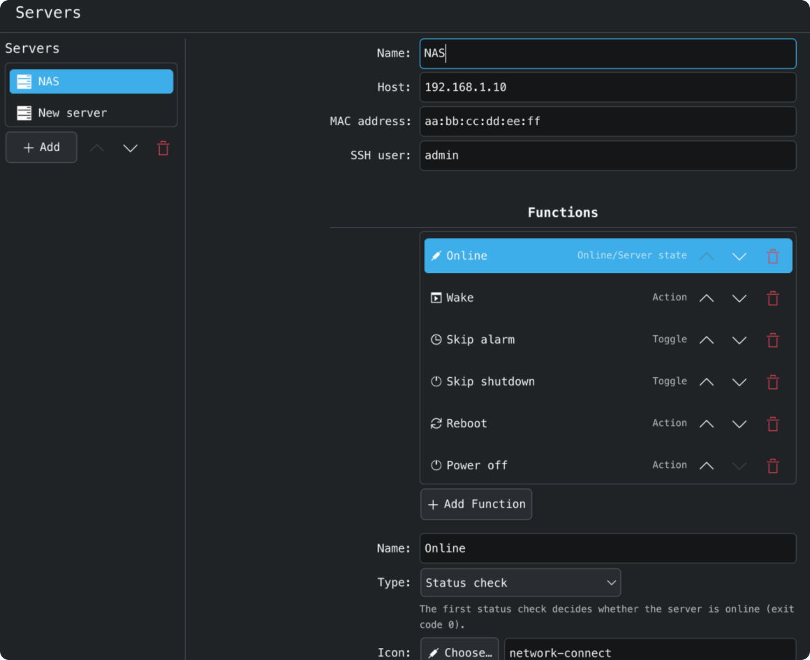
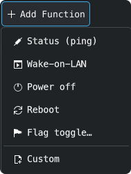
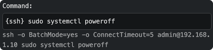
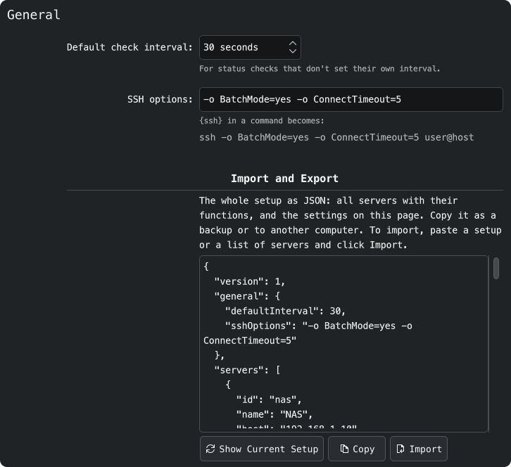
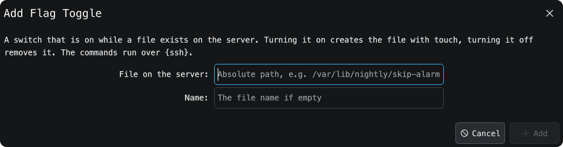

# Server Control

<p align="center">
  <b><a href="#install">Install</a></b> |
  <b><a href="#configure">Configure</a></b> |
  <b><a href="#server-setup">Server setup</a></b> |
  <b><a href="#update">Update</a></b> |
  <b><a href="https://github.com/TisiNen/ServerControl/issues">Report a bug</a></b>
</p>

A KDE Plasma 6 panel widget for controlling home servers. It shows whether your servers are
online, wakes them with Wake-on-LAN, toggles flag files and powers them off or reboots them
over SSH.

Nothing is hardcoded: you define your servers and their functions in the widget settings. Each
function is a shell command, so the widget works with whatever your servers need.


<p align="center">
  
  
</p>
<p align="center"><em>The popup with the server online (left) and offline (right). Functions that don't fit the current state are greyed out.</em></p>

<p align="center">
  
  &nbsp;&nbsp;
  
  &nbsp;&nbsp;
  
</p>
<p align="center"><em>The panel icon: all servers online, some online, none online.</em></p>

- **Panel icon** with a status dot: green (all servers online), orange (some), grey (none).
- **Popup** with one row per server: a status dot plus a button or switch for each function.
- **Three function types:**
  - **Status**: a command that runs on an interval; exit code 0 means online.
  - **Action**: a button, e.g. Wake, Reboot, Power off. Optionally with a confirmation dialog.
  - **Toggle**: a switch with commands to read, turn on and turn off a state, e.g. a flag file
    on the server.
- **Placeholders** in commands: `{host}`, `{mac}`, `{user}`, `{name}` and `{ssh}`
  (becomes `ssh <SSH options> {user}@{host}`).
- **Tailscale**: away from home, servers are reached at their Tailscale address, with a
  "via Tailscale" badge. Servers without one show as not reachable, and Wake-on-LAN is disabled.
- **Templates** for common functions: ping status, Wake-on-LAN, power off, reboot, flag toggle.
- **Import/export** of the whole setup as JSON (copy and paste), for backups or moving to
  another machine.

<p align="center">
  
  
</p>
<p align="center"><em>Left: functions can ask for confirmation and show the exact command. Right: a failed command shows ✗ and the last line of its error output.</em></p>

## AI disclaimer

This widget was developed with the help of AI: most of the code and documentation was written
by [Claude Code](https://claude.com/claude-code) (Anthropic) under the direction of the
author, who specified the behaviour, reviewed the changes and tested the widget on a real
Plasma 6 desktop with real servers.

Read the commands in your configuration before you use them. The widget runs them as your user,
and power-off commands do what they say.

## Requirements

- KDE Plasma 6.0 or later.
- On the desktop, depending on the functions you use:
  - `ssh` (OpenSSH client)
  - `ping`
  - a Wake-on-LAN tool: `wakeonlan` or `wol`
- On each server: an SSH server, and the setup described in [Server setup](#server-setup).

## Install

<details>
<summary><b>From a release</b> (.plasmoid file)</summary>

Download the `.plasmoid` file from the
[latest release](https://github.com/TisiNen/ServerControl/releases/latest). Then either:

- right-click the panel → **Add or Manage Widgets…** → **Get New** → **Install Widget From
  Local File…** and choose the file, or
- install it in a terminal:

  ```sh
  kpackagetool6 -t Plasma/Applet -i servercontrol-*.plasmoid
  ```

</details>

<details>
<summary><b>From source</b> (git)</summary>

```sh
git clone https://github.com/TisiNen/ServerControl.git
cd ServerControl
kpackagetool6 -t Plasma/Applet -i package/
```

</details>

After installing, right-click the panel → **Add or Manage Widgets…**, search for **Server Control** and drag
it onto the panel.

## Configure

Open the widget's settings: right-click the icon → **Configure Server Control…**.

On the **Servers** page, add your servers (name, host, optional Tailscale host, MAC address,
SSH user) and give each one its functions.

<p align="center">
  
</p>
<p align="center"><em>The Servers page: servers on the left, the selected server's fields and functions on the right.</em></p>

**Add Function** offers templates with sensible defaults, which you can edit afterwards. Under
each command field, the settings show the command as it will run on this server, with all
placeholders filled in.

<p align="center">
  
  &nbsp;&nbsp;
  
</p>
<p align="center"><em>Left: the function templates. Right: a command and its preview with placeholders substituted.</em></p>

The **General** page sets the panel icon, the default check interval, the SSH options used for
`{ssh}` and Tailscale support (see [Tailscale](#5-tailscale-optional)), and has the import/export area. `examples/home-server.example.json` is a complete example: paste
it into the text area, click **Import**, then adjust host, MAC address, user and paths on the
Servers page. **Apply** saves, **Cancel** discards.

<p align="center">
  
</p>
<p align="center"><em>The General page.</em></p>

## Update

<details>
<summary><b>From a release</b> (.plasmoid file)</summary>

Download the new `.plasmoid` file from the
[latest release](https://github.com/TisiNen/ServerControl/releases/latest), then:

```sh
kpackagetool6 -t Plasma/Applet -u servercontrol-*.plasmoid
systemctl --user restart plasma-plasmashell
```

If the folder holds more than one `.plasmoid` file, give the exact file name instead of
`servercontrol-*.plasmoid`.

</details>

<details>
<summary><b>From source</b> (git)</summary>

```sh
cd ServerControl
git pull
kpackagetool6 -t Plasma/Applet -u package/
systemctl --user restart plasma-plasmashell
```

</details>

Restarting `plasmashell` reloads the panel so the new version is used. Your configuration is
kept.

## Uninstall

Remove the widget from the panel, then:

```sh
kpackagetool6 -t Plasma/Applet -r com.github.TisiNen.servercontrol
```

## Server setup

The widget runs commands with your user's privileges, exactly as configured. For SSH-based
functions to work from a panel widget, they must never ask for a password. Do these steps once
per server.

### 1. Passwordless SSH

Create a key on the desktop if you don't have one yet:

```sh
ssh-keygen -t ed25519
```

Copy it to the server (replace user and host):

```sh
ssh-copy-id <user>@<server>
```

If your key has a passphrase, make sure it is loaded in an SSH agent when you log in (KDE's
`ksshaskpass` with `ssh-add`, or your distribution's agent setup). Alternatively, use a
dedicated key without a passphrase and add `-i ~/.ssh/<keyfile>` to the SSH options in the
widget's **General** settings.

Test it. This must print `ok` without asking anything:

```sh
ssh -o BatchMode=yes -o ConnectTimeout=5 <user>@<server> echo ok
```

If this fails with "Host key verification failed", connect once without `BatchMode` and accept
the host key.

The widget uses `-o BatchMode=yes -o ConnectTimeout=5` by default, so a missing key makes the
command fail quickly instead of waiting for a password. Keep `BatchMode=yes` if you change the
SSH options.

### 2. Passwordless sudo for power off and reboot

The **Power off** and **Reboot** templates run `sudo systemctl poweroff` / `reboot` on the
server. Allow exactly these two commands without a password.

On the server, find the path of `systemctl`:

```sh
command -v systemctl
```

Create a sudoers drop-in with `visudo`, which checks the syntax before saving:

```sh
sudo visudo -f /etc/sudoers.d/servercontrol
```

Add this line, with your user name and the path from above:

```
<user> ALL=(root) NOPASSWD: /usr/bin/systemctl poweroff, /usr/bin/systemctl reboot
```

Test from the desktop. This must not ask for a password (`-l` only lists, it doesn't power off):

```sh
ssh -o BatchMode=yes <user>@<server> sudo -n -l /usr/bin/systemctl poweroff
```

### 3. Wake-on-LAN

Wake-on-LAN only works on the local network.

- Enable Wake-on-LAN in the server's BIOS/UEFI.
- Enable it on the network card, and make the setting persistent (how depends on your
  distribution, e.g. NetworkManager, systemd-networkd or a udev rule). To check it:

  ```sh
  sudo ethtool <interface> | grep Wake-on    # "g" means magic packet is enabled
  ```

- Install a Wake-on-LAN tool on the desktop, e.g. `wakeonlan` (Debian/Ubuntu, Fedora,
  Arch) or `wol`. The **Wake-on-LAN** template uses `wakeonlan {mac}`; change the command if
  you use another tool.
- Enter the server's MAC address in the widget settings.

### 4. Flag toggles (optional)

The **Flag toggle** template creates a switch that checks, creates and deletes a file on the
server (`test -f`, `touch`, `rm -f` over SSH). A script on the server can then react to that
file.

<p align="center">
  
</p>

The SSH user needs write access to the directory of the flag file. The widget only manages
the file; the script that reads it is up to you.

### 5. Tailscale (optional)

If you use [Tailscale](https://tailscale.com) to reach your servers when you are away from
home, check **Enable Tailscale support** on the General page and click **Apply**. Then the
Servers page has a **Tailscale host** field: enter each server's Tailscale IP or MagicDNS name.

With the status checks, the widget runs the **Tailscale check** from the General page. By
default that is

```sh
tailscale status --json | grep -q '"BackendState": *"Running"'
```

While it succeeds (exit code 0):

- `{host}`, and with it `{ssh}`, use the server's Tailscale host. The popup shows
  "via Tailscale" next to it.
- Servers without a Tailscale host show as **Not reachable**, and their buttons are disabled.
- Functions that use `{mac}` (Wake-on-LAN) are disabled: Wake-on-LAN needs the local network.

The command preview in the settings shows both versions of a command, LAN and Tailscale.
Uncheck **Enable Tailscale support** to turn it all off again; the Tailscale hosts you entered
are kept.

## Development

See [`CLAUDE.md`](CLAUDE.md) for the specification and development workflow. Quick preview without installing (needs `plasma-sdk`):

```sh
plasmoidviewer -a package/
```

## License

GPL-3.0-or-later. See [`LICENSE`](LICENSE).
